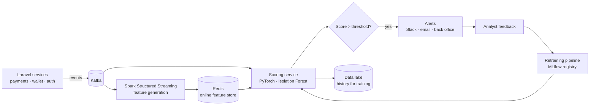

# Streaming Anomaly Detection

**Real-time anomaly detection for transactions and systems.** Event streaming, online feature generation, ML scoring and alerting in under a minute.

> **Building in public.** The architecture and roadmap are published first. Code, benchmarks and results land milestone by milestone. Watch the repo to follow along.

## Problem

Operations and risk teams find abnormal behavior too late: fraudulent wallet top-ups, unusual refund bursts, failing payment providers, or API error spikes. Batch reports surface them hours later, after the damage is done.

## Solution

A streaming ML architecture, designed around a fintech wallet like [Easy Pay](https://github.com/m-makhlafi/easy-pay):

- **Event capture** from application services (Laravel events → Kafka topics)
- **Streaming feature generation** with Spark Structured Streaming: rolling counts, velocities, amounts vs. user baseline
- **Online feature store** in Redis for low-latency lookups
- **Online inference**: Isolation Forest baseline plus a PyTorch autoencoder / sequence model
- **Anomaly scoring** with per-segment thresholds and explanations of the top contributing features
- **Real-time alerting** to Slack / email / back-office, with feedback that labels alerts for retraining
- **Experiment tracking** and model versioning with MLflow

## Architecture

## Tech stack

| Layer | Technologies |
| --- | --- |
| Streaming | Apache Kafka, Spark Structured Streaming |
| Features | Redis online feature store, offline features in a data lake (Parquet) |
| Models | Python, PyTorch (autoencoder / sequence models), scikit-learn (Isolation Forest baseline) |
| MLOps | MLflow tracking + registry, drift monitoring, scheduled retraining |
| Serving | FastAPI scoring service |
| Platform | Docker, Kubernetes |
| Producers | Laravel event publishers, synthetic transaction generator for demos |

## Targets and how they are measured

| Target | Metric | Method | Result |
| --- | --- | --- | --- |
| Detection in under one minute (vs. hours in batch) | Event-to-alert latency p95 | Injected anomalies in a replayed stream | pending |
| +27% detection precision vs. rule-based baseline | Precision @ fixed recall | Labeled synthetic + public fraud datasets | pending |
| Sustained throughput | Events / second | Load test on Kafka + Spark | pending |

## Roadmap

- [x] Architecture and design document
- [ ] Synthetic transaction generator and Kafka topics
- [ ] Spark streaming features + Redis feature store
- [ ] Baseline Isolation Forest scorer
- [ ] PyTorch autoencoder / sequence model, tracked in MLflow
- [ ] Alerting and analyst feedback loop
- [ ] Drift monitoring and retraining pipeline
- [ ] Kubernetes deployment and benchmark report

---

Built by [Mohammed Al-Mekhlafi](https://github.com/m-makhlafi) · Full-Stack & AI Engineer
